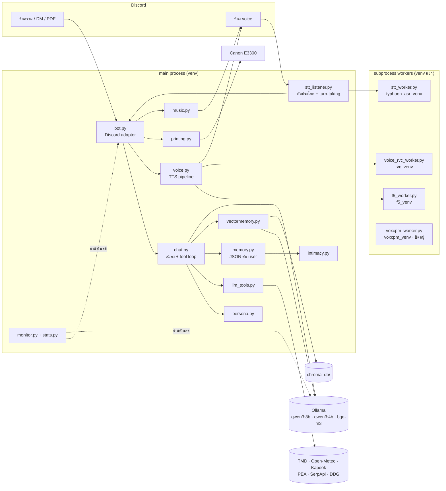
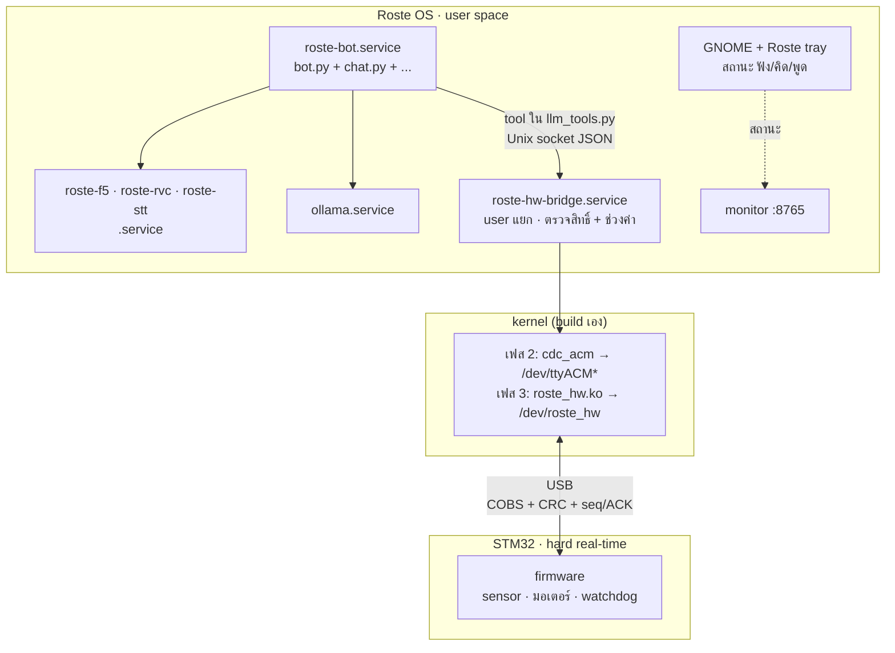

# 🏗️ Roste Architecture — โครงสร้างระบบของรอสเต้

> อัปเดต: 18 ต.ค. 2569
> ส่วนที่ 1–3 คือ**สภาพจริงตอนนี้** (บน Windows) ส่วนที่ 4 คือ**เป้าหมายบน Roste OS** ([ROSTE_OS.md](ROSTE_OS.md))
> ซึ่งยังไม่ได้ทำ — อย่าอ่านส่วนที่ 4 เป็นของที่มีอยู่แล้ว

---

## 📌 หลักที่ทุกส่วนยึด

| หลัก | ทำไม | เห็นได้ที่ |
|------|------|-----------|
| **local-first** — LLM, embedding, TTS, STT รันในเครื่อง | ไม่ส่งบทสนทนาออกนอกเครื่อง | Ollama, workers ทั้งหมด |
| **สมองไม่รู้จัก Discord** | เทสบทสนทนาได้โดยไม่มี Discord, เปลี่ยนช่องทางได้ | `chat.py` รับ `(user_id, user_name, message)` คืน string |
| **dependency หนักแยก process + venv** | torch/NeMo/RVC ชนเวอร์ชันกันเอง | workers คุย JSON ผ่าน stdin/stdout |
| **LLM ไม่ตัดสินสิทธิ์** | fact จาก "จำไว้ว่า..." ปน context หลอก LLM ได้ | gate อยู่ใน handler (ดู ROADMAP หัวข้อความปลอดภัย) |
| **ไม่มี PII ใน log/สถิติ** | dashboard ต้องไม่กลายเป็นรูรั่ว | `stats.py` เก็บแค่ตัวเลข, เนื้อหาอยู่ที่ DEBUG เท่านั้น |
| **ทุกอย่างภายนอก degrade ได้** | Ollama/nvidia-smi/เว็บล่ม ต้องไม่ทำบอทล่ม | fallback ทุกชั้น (F5→edge-tts, TMD→Open-Meteo, LLM→heuristic) |

---

## 1️⃣ ภาพรวม (ตอนนี้)



---

## 2️⃣ แต่ละชั้น

### 🔌 ชั้นช่องทาง (interface)
| ไฟล์ | หน้าที่ |
|------|---------|
| [`bot.py`](../bot.py) | ตัวเดียวที่รู้จัก discord.py — รับข้อความ, rate limit, DM allowlist, ส่งต่อ `chat.py`, คุม voice/print/karaoke, LLM intent-gate ว่าถูกเรียกชื่อจริงไหม |
| [`stt_listener.py`](../stt_listener.py) | AudioSink รับ PCM ต่อผู้พูด → ตัดประโยคจาก RMS เงียบ → ถอดเสียง → ถามโมเดลเล็กว่าพูดจบหรือยัง (semantic turn-taking) → แก้ชื่อบอทที่ ASR เพี้ยน |

**STT ปิดอยู่** (`STT_ENABLED = False` ที่ [`bot.py:112`](../bot.py#L112)) — รอ wake word ตาม roste-plan.md รอบ 4

### 🧠 ชั้นสมอง
| ไฟล์ | หน้าที่ |
|------|---------|
| [`chat.py`](../chat.py) | `ask_ollama` — ประกอบ prompt, tool-calling loop, summarize, auto-remember |
| [`persona.py`](../persona.py) | `SYSTEM_PROMPT`, few-shot, moods, `fix_persona_slips()` (validation layer รอบสอง) |
| [`llm_tools.py`](../llm_tools.py) | นิยาม tool + handler + `select_tools()` (คัด tool ตามคำถาม กัน attention dilution) — **ต่อ tool ใหม่ที่นี่ที่เดียว** |
| [`ollama_client.py`](../ollama_client.py) | HTTP client บางๆ ไม่รู้จัก business logic (กัน circular import) |

tool ตอนนี้ **อ่านอย่างเดียวทั้งหมด** ยกเว้น `stop_voice`: เวลา, อากาศ, ไฟดับ, น้ำมัน, ค้นร้าน, ค้นเว็บ

### 💾 ชั้นความจำ
| ไฟล์ | เก็บที่ | หน้าที่ |
|------|--------|---------|
| [`memory.py`](../memory.py) | `memory/<user_id>.json` | ชื่อ, facts, summaries (tag เจ้าของ), supersede, decay, roste facts |
| [`vectormemory.py`](../vectormemory.py) | `chroma_db/` | semantic recall + RAG PDF — retrieve top-k (bge-m3) → rerank (qwen3:8b) |
| [`intimacy.py`](../intimacy.py) | (คำนวณจาก memory) | tier ความสนิทตาม Knapp — **คุมแค่สำเนียง ไม่คุมสิทธิ์/ข้อมูล** |

semantic recall กับ PDF query ยิงขนานกัน (คนละ collection ไม่พึ่งผลกัน)

### 🛠️ ชั้นเครื่องมือ / โลกจริง
| ไฟล์ | หน้าที่ |
|------|---------|
| [`datasources.py`](../datasources.py) | อากาศ (TMD → Open-Meteo), น้ำมัน, ไฟดับ PEA, จังหวัด |
| [`websearch.py`](../websearch.py) | SerpApi → DuckDuckGo |
| [`printing.py`](../printing.py) | PDF → SumatraPDF + `win32print` (**ผูก Windows**) |
| [`music.py`](../music.py) | karaoke — เล่นไฟล์ cover จาก `Karaoke/` |
| [`tasks.py`](../tasks.py) | task state machine (SQLite) — **ร่าง ยังไม่ต่อเข้าบอท** |

### 🔊 ชั้นเสียง
[`voice.py`](../voice.py) สตรีมทีละประโยค (crfcut) — เล่นประโยคแรกได้ก่อนเจนเสร็จทั้งคำตอบ
```
หลัก:     strip_emoji → f5_preprocess → F5 (warm) → pitch
สำรอง:    edge-tts → ffmpeg → RVC (warm)
ต่อ segment: F5 retry 1 → edge-tts → ข้าม   (พังกลางทางไม่เงียบ ไม่เล่นซ้ำ)
```
VoxCPM ลองแล้วย้อนกลับ (`VOXCPM_ENABLED = False`)

### 📈 ชั้นเฝ้าดู
[`stats.py`](../stats.py) จับเวลาแต่ละ stage ด้วย contextvars (ตัวเลขล้วน) →
[`monitor.py`](../monitor.py) เสิร์ฟ `dashboard.html` ที่ `127.0.0.1:8765` รวม psutil + nvidia-smi + Ollama `/api/ps`

---

## 3️⃣ เส้นทางข้อมูลหลัก

**ข้อความ → คำตอบ**
```
Discord → bot.py (rate limit / allowlist / intent)
        → chat.ask_ollama
            ├─ memory: facts + summaries ของ user คนนี้
            ├─ vectormemory: semantic recall ‖ PDF RAG   (ขนาน)
            ├─ select_tools(คำถาม) → ยื่นเฉพาะ tool ที่เกี่ยว
            └─ Ollama ↔ tool handler (วนจนได้คำตอบ)
        → persona.fix_persona_slips
        → bot.py ส่งข้อความ  (+ voice.py ถ้าอยู่ในห้อง voice)
        → background: summarize / auto-remember
```

**เสียงเข้า (เมื่อเปิด STT)**
```
PCM 48k stereo → stt_listener (ต่อผู้พูด, RMS เงียบ) → 16k mono
  → stt_worker (typhoon-asr) → จบประโยคหรือยัง? (qwen3:4b, fallback heuristic)
  → _fix_bot_name → bot.py → เส้นทางเดียวกับข้อความ
```

**process model** — main process 1 ตัว + worker ละ 1 process ต่อ venv โหลดโมเดลครั้งเดียว (warm)
คุยด้วย JSON บรรทัดเดียวผ่าน stdin/stdout + timeout ทุกการอ่าน Ollama เป็น server แยก
ตอนนี้ปลุกด้วย `start.bat` และ restart ด้วย [`restart_bot.ps1`](../restart_bot.ps1)

---

## 4️⃣ เป้าหมายบน Roste OS — *ยังไม่ได้ทำ*

ชั้นสมอง/ความจำ/เสียง**ไม่เปลี่ยนโครง** สิ่งที่เพิ่มคือชั้นล่างสุด (OS + hardware) และตัวคุม process



### สิ่งที่เปลี่ยน
| ตอนนี้ | บน Roste OS |
|--------|-------------|
| `start.bat` + `restart_bot.ps1` kill จาก CommandLine | systemd unit ต่อ service, `Restart=on-failure`, cgroup เก็บลูกให้หมด |
| bot.py spawn worker เอง | เลือกได้: คงไว้แบบเดิม หรือแยกเป็น service — **ตัดสินหลังวัด cold start** |
| log ไฟล์ + console | `journalctl -u roste-*` + `logs/bot.log` เดิม |
| `printing.py` (win32print) | CUPS |
| ไม่มี hardware | `hw_bridge` + STM32 |

### กฎของชั้น hardware (ต้องมีตั้งแต่วันแรก)
1. **สิทธิ์เช็คในโค้ดสองชั้น** — handler ใน `llm_tools.py` เช็ค `user_id` ของข้อความปัจจุบัน
   และ `hw_bridge` เช็ค allowlist + ช่วงค่า + rate ซ้ำอีกรอบ LLM ไม่มีสิทธิ์ตัดสินทั้งสองชั้น
2. **`hw_bridge` เป็น process เดียวที่เปิดอุปกรณ์ได้** — udev ให้สิทธิ์เฉพาะ group ของ user นั้น
   bot.py แตะ `/dev/*` ตรงไม่ได้
3. **STM32 ไม่เชื่อ Linux** — มี watchdog: ฝั่ง host เงียบเกินกำหนด → กลับสถานะปลอดภัยเอง
   และเช็คขอบเขตค่าใน firmware อีกชั้น
4. **real-time อยู่บน MCU** — Linux ส่ง "เป้าหมาย" (เปิด/ปิด, ตำแหน่ง, ความเร็ว) ไม่ส่งสัญญาณ timing
5. **ทุกคำสั่งมีผลตอบกลับ** — ACK + สถานะจริงจาก STM32 รอสเต้รายงานผลจากสถานะจริง ไม่ใช่จากการที่ส่งคำสั่งออกไป
   (หลักเดียวกับ printing ที่เช็คคิวค้างแทนการเชื่อว่าพิมพ์ออก)

### ยังไม่ตัดสินใจ
- [ ] worker เป็น service แยก หรือให้ bot.py spawn เหมือนเดิม
- [ ] protocol bot ↔ `hw_bridge`: Unix socket JSON (ร่างไว้) หรือ D-Bus (ถ้า GUI tray ต้องฟัง event ด้วย)
- [ ] `tasks.py` เป็นที่เก็บสถานะงาน hardware ที่กินเวลาหลายขั้น (เช่น "เปิดไฟอีก 10 นาที") หรือไม่
